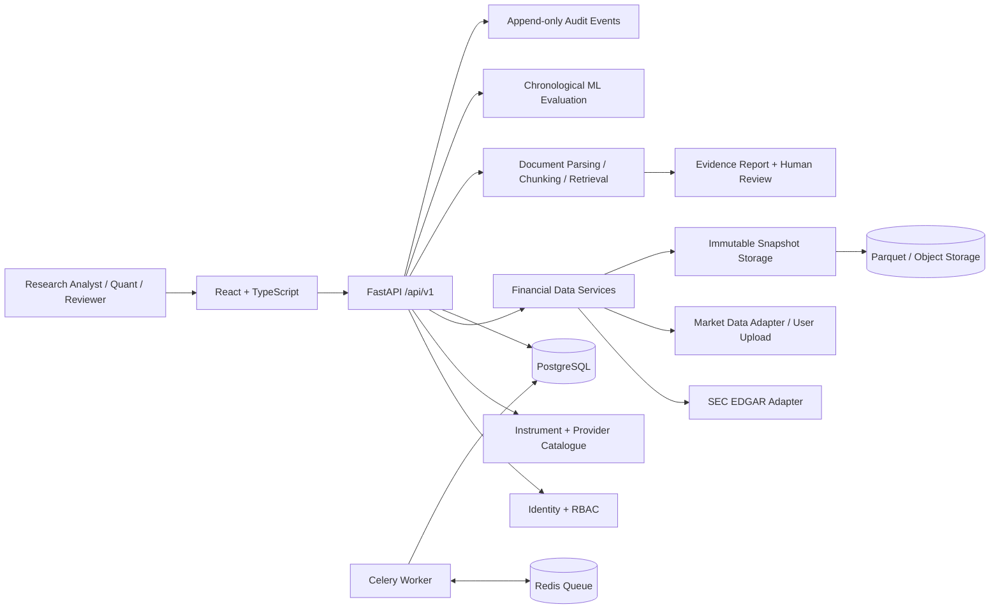

# FinSight ResearchOps — Architecture

## Product boundary

FinSight ResearchOps is a portfolio-grade financial research and quantitative strategy operations application. The initial market scope is US-listed equities and ETFs, using permitted historical market data and public SEC filings. The first release supports research, experimentation, evaluation and paper simulation only. It does not provide investment advice or real-money broker execution.

## Architecture style

Use a modular monolith for domain logic with separate API and background-worker processes. Avoid premature microservices. The API layer validates requests, authenticates users, enforces role permissions and calls application services. Phase 3 document ingestion, research Q&A and supervised model evaluation, plus Phase 4 RL training, have staged Celery job paths with durable status/idempotency and queue-dispatch retry. Synchronous endpoints remain for bounded local use and acceptance tests.

## Runtime components

| Component | Responsibility | Current verified state |
|---|---|---|
| React + TypeScript + Vite | Analyst-facing web shell | Source implemented: login, overview, research, intelligence, Experiment Lab, Backtest Lab, RL Strategy Lab, Model Governance, Paper Execution and operations; 14 TS/TSX files syntax-transpiled; production bundle/browser not run |
| FastAPI | Versioned REST API and OpenAPI docs | Implemented |
| PostgreSQL + SQLAlchemy | Durable application records | Models and Alembic migration implemented; Postgres runtime not yet validated here |
| Redis + Celery | Background job broker and workers | Document, research, supervised-ML and PPO/SAC RL task code/queue adapters implemented; broker/worker runtime not yet validated here |
| SEC EDGAR adapter | Public company submissions metadata | Implemented with a bounded HTTP client; live SEC call not yet verified here |
| Market-data snapshots | Content-hashed, immutable ingestion records | Implemented using Parquet output; requires installed PyArrow and a working data-store mount |
| Governance + risk | Versioned model registry, artifact integrity, deterministic risk decisions, independent review and admin promotion/rollback | Implemented and API-tested; production database/runtime not yet validated |
| Paper execution | Simulated accounts, orders, fills, positions, fees, ledger, reconciliation and kill switch | Internal paper broker and API/tests implemented; no live broker connector or live-order route |
| Audit events | Trace security- and data-affecting actions | Implemented across identity, catalogue, data, research, governance and paper account state changes |

## Core engineering rules

1. API routes call services, not raw model internals or frontend code.
2. External providers are accessed through adapters; provider secrets never enter database configuration JSON or Git.
3. Every market snapshot preserves provider, instrument, interval, date range, adjustment policy, row count, schema version and SHA-256 hash.
4. A changed source payload creates a new snapshot; historical snapshots are not overwritten.
5. Authorization is enforced by backend dependencies; UI hiding is not a security boundary.
6. AI agents introduced in Phase 3 are read-only and cannot approve models, modify risk limits or submit orders.
7. The deterministic risk engine is independent of LLM output.
8. Long-running operations use job IDs and workers; HTTP handlers should not hold open training or research runs.
9. Every material state change emits an audit event.

## Delivered API surface (Phases 1–4)

- `POST /api/v1/auth/register` — analyst self-registration (configurable).
- `POST /api/v1/auth/login` — bearer access token.
- `GET /api/v1/auth/me` — authenticated identity and roles.
- `GET/POST /api/v1/instruments` — catalogue read; admin/quant write.
- `GET /api/v1/providers` — enabled provider catalogue.
- `POST /api/v1/data/ingestions/market` — ingest supplied OHLCV bars into an immutable Parquet snapshot.
- `POST /api/v1/data/ingestions/market/csv` — validate a CSV upload and create the same immutable snapshot.
- `GET /api/v1/data/snapshots` — list permitted snapshots.
- `POST /api/v1/data/ingestions/sec/{cik}` — fetch and persist SEC submissions metadata.
- `GET /api/v1/audit/events` — restricted audit-event inspection.
- `GET /api/v1/users` and `PATCH /api/v1/users/{id}/roles` — administrator-only identity administration.
- `POST /api/v1/jobs/ping` and `GET /api/v1/jobs/{id}` — persisted async job lifecycle and queue smoke test.
- `POST /api/v1/documents/upload` and `POST /api/v1/documents/upload/jobs` — bounded safe document ingestion, synchronous or staged/queued. `GET /api/v1/documents` lists provenance metadata.
- `POST /api/v1/research/ask` and `GET /api/v1/research/reports` — hybrid lexical/vector retrieval, optional reranking, source-cited reports, sentence-level lexical/numeric claim screening and stored workflow checkpoints.
- `GET /api/v1/research/reports/{id}/checkpoints` — inspect persisted node snapshots; `POST /api/v1/research/reports/{id}/resume` resumes a failed report from the latest source-hash-verified checkpoint without refreshing evidence.
- `POST /api/v1/research/reports/{id}/decision` — ADMIN/RISK_REVIEWER human approval/rejection; non-admin authors cannot self-approve.
- `POST /api/v1/ml/evaluations` and `POST /api/v1/ml/evaluations/jobs` — bounded synchronous or queued supervised evaluation pinned to a dataset snapshot and feature-set version.
- `GET /api/v1/ml/evaluations` and `/compare` — inspect metrics and compare models only on the same data/feature lineage.
- `POST /api/v1/ml/sentiment` — lexicon baseline or optional FinBERT provider.
- `POST /api/v1/jobs/{id}/retry` — owner/ADMIN retry of a queue-dispatch failure.
- `POST /api/v1/research/hypotheses` and `GET /api/v1/research/hypotheses` — create/list evidence-linked draft hypotheses.
- `POST /api/v1/research/hypotheses/{id}/submit-review` — hypothesis owner or ADMIN moves a draft into review.
- `POST /api/v1/research/hypotheses/{id}/decision` — ADMIN/RISK_REVIEWER approval or rejection of a submitted hypothesis; state changes are audited.
- `POST/GET /api/v1/features/versions` — immutable, content-hashed feature-set definitions pinned to READY snapshots.
- `POST/GET /api/v1/experiments` — reproducible experiment specifications tied to approved hypotheses, a READY snapshot and a matching feature-set version; an optional benchmark snapshot is pinned to a symbol and date range.
- `POST /api/v1/experiments/{id}/runs` and `GET /api/v1/experiments/{id}/runs` — idempotent run submission and run-status/metrics inspection.
- `GET /api/v1/experiments/{id}/runs/comparison` — compare run return, Sharpe, drawdown, benchmark return/information ratio and persisted risk decision.
- `GET /api/v1/experiments/{id}/runs/{run_id}/risk-review` — retrieve the deterministic risk policy, observations, warnings and hard breaches.
- `POST /api/v1/rl/evaluations/jobs` — idempotently queue PPO/SAC training on a READY Parquet snapshot and matching versioned feature set; only ADMIN/QUANT_RESEARCHER.
- `GET /api/v1/rl/evaluations` and `/api/v1/rl/evaluations/comparison` — inspect saved results and compare successful OOS evaluations only on the exact same snapshot/feature lineage.
- `GET/POST /api/v1/governance/models` — inspect/register supervised or RL evaluation results as candidate model versions.
- `GET /api/v1/governance/models/{id}/risk-review` and `/decisions` — inspect deterministic risk findings and independent decision history.
- `POST /api/v1/governance/models/{id}/decision`, `/promote` and `/rollback` — reviewer/admin decision and admin-only lifecycle operations; candidate authors cannot approve themselves; promotion requires risk PASS.
- `POST/GET /api/v1/execution/accounts` — create/list internal paper accounts.
- `GET /api/v1/execution/accounts/{id}/summary` and `/audit` — inspect paper cash, equity, exposure, positions, orders, fills, ledger and audit records.
- `POST/GET /api/v1/execution/accounts/{id}/orders` — simulated paper order and order inspection, with idempotency and deterministic post-trade exposure/cash limits.
- `POST /api/v1/execution/accounts/{id}/kill-switch` and `/reconcile` — halt new orders and reconcile ledger from fill history; repair/deactivation restricted by backend role policy.
- `GET /api/v1/health` — liveness; `GET /api/v1/health/ready` — database and Redis readiness.

## UI source currently implemented

The UI includes sign-in, ResearchOps Overview, Research Workspace (SEC submissions and historical OHLCV upload), Research Intelligence (document upload, evidence-grounded question answering, report review and supervised model evaluation), Experiment Lab (hypotheses, review actions, feature-set versioning, experiment specifications and queued runs), Strategy & Backtest Lab (completed run comparison and risk-review inspection), RL Strategy Lab (PPO/SAC queued evaluation, status/retry and OOS comparison), Model Governance (candidate registration, deterministic risk review, independent approval, promotion/rollback) and Paper Execution (accounts, simulated order submission, portfolio summary, kill switch, reconciliation and audit history), plus Operations & Administration. Phase 5 feedback/monitoring page remains a later increment. A browser/Vite production build has not been verified in this sandbox.

## Phase 2 implementation delivered in this workspace

Phase 2 includes independently reviewed evidence-linked hypotheses, immutable feature-set versions, strict feature declaration and target separation, chronological train/validation/test windows with horizon-plus-embargo purge, and reproducible configuration/data/feature fingerprints. The worker verifies snapshot and configuration hashes, materializes the declared feature frame, runs a registered baseline (buy-and-hold, moving-average crossover or RSI mean-reversion), and persists metrics/equity/feature/configuration artifacts. Evaluation supports a held-out test window or non-overlapping rolling walk-forward folds, train/validation diagnostic metrics, and optional pinned benchmark-relative alpha, beta, tracking error and information ratio. Vectorized and event-driven portfolio engines include next-close fills, cash, holdings, exposure, turnover, commission and slippage. A deterministic risk policy persists PASS/REVIEW/REJECT decisions that cannot be altered by LLM output. Run comparison APIs/UI and local JSON tracking are included; an optional MLflow adapter is available. Automated offline tests and SQLite migration lifecycle pass. Celery/Redis/PostgreSQL/PyArrow and the browser production build remain environment-dependent checks and are not claimed as verified in this sandbox.

## Phase 3 architecture boundary

The RAG path stores document/chunk hashes, source metadata and provider-versioned vectors. Deterministic signed feature hashing is the offline default; local SentenceTransformer embeddings are optional. Retrieval combines lexical/cosine scores and MMR, with optional cross-encoder reranking. SQLite/local mode stores vectors as JSON; PostgreSQL mode uses the pgvector 384-dimension column and cosine HNSW index from migration 0006, with a validated backfill script. The default synthesizer is extractive; an optional LangChain OpenAI synthesizer is configurable behind the same citation gate. The workflow can run inline or as a LangGraph StateGraph when the extra is installed; each node emits a persisted privacy-minimized DB checkpoint. The claim screen checks sentence-level citation linkage, lexical overlap and numeric tokens; it is a heuristic, not semantic entailment, so independent review remains mandatory. Document and supervised-ML jobs use Celery with persisted idempotency/status and owner-scoped retry for dispatch failures. Model/sentiment optional providers are implemented but their pretrained weights/live services are not verified in this sandbox. Supervised evaluations are chronologically split and tied to content-hashed data/feature definitions, with snapshot-matched model comparison.

## Next architectural increments

Phase 3 external runtime/provider validation remains open (PostgreSQL/pgvector ANN, Redis/Celery, downloaded model weights, real LLM credentials, labeled FinBERT calibration data and frontend build/browser acceptance). Phase 4 source/API/UI paths now cover governance, RL and paper-only execution; its runtime gates are PostgreSQL/Redis/Celery, Gymnasium/Stable-Baselines3 actual training/artifact loading and frontend production/browser acceptance. Phase 5 adds outcome feedback, monitoring, recovery tests and repeatable deployment.
