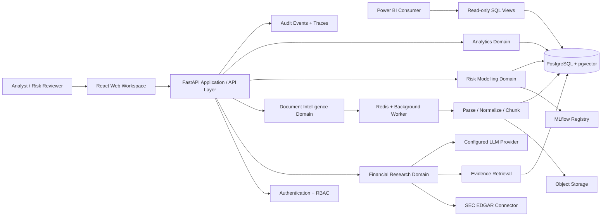
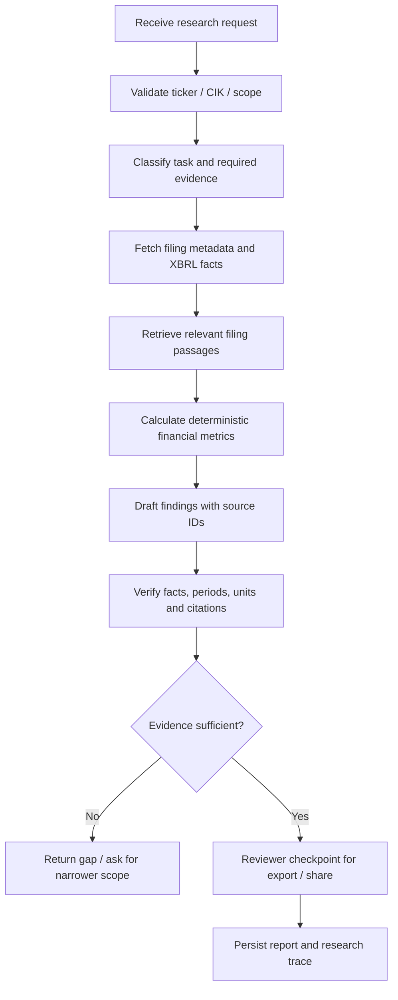

# FinSight AI — System Architecture

## 1. Goals and design constraints

**Primary goal:** provide an auditable financial research and risk-analytics workspace over public filings and controlled demonstration datasets.

**Non-goals for the portfolio release:** production banking, custody of money, live payment processing, loan origination/approval, autonomous trading, or claims of regulatory compliance.

Design constraints:

- Evidence first: LLM answers must reference retrieved source passages or structured records.
- Deterministic risk scoring: ML prediction is a separately versioned service, not an LLM guess.
- Least privilege: agents only receive narrowly scoped read-only tools.
- Tenant isolation: every user-owned document, conversation, job, and result is scoped to an authenticated tenant/workspace.
- Replayability: preserve source versions, dataset versions, model versions, prompts, and execution metadata.
- Incremental complexity: modular monolith first; extract independently scalable services only when there is evidence to do so.

## 2. Context diagram

## 3. Logical components

### 3.1 API and identity boundary

FastAPI is the public application boundary. It validates inputs, authenticates requests, enforces authorization, applies rate limits, attaches a request/correlation ID, and routes to domain services. The API layer must not contain long-running model training, bulk document parsing, or multi-minute research orchestration inline.

Initial route groups (all versioned under `/api/v1`):

| Route group | Purpose | Access policy |
|---|---|---|
| `/auth/*` | Login/session/token flows | Public only for login; protected thereafter |
| `/workspaces/*` | Tenant/workspace management | Workspace membership |
| `/documents/*` | Upload, list, status, citations | Owner/analyst with document scope |
| `/research/*` | Start and inspect research runs | Analyst; reviewer for approval actions |
| `/fraud/*` | Score transactions and inspect alerts | Risk analyst / reviewer |
| `/credit/*` | Score applications and inspect explanations | Risk analyst / reviewer |
| `/analytics/*` | KPI and reporting endpoints | Analyst; read-only consumer roles |
| `/jobs/*` | Job status, retry, cancellation | Job owner / operator |
| `/health` | Liveness | Public, no sensitive details |

Use Pydantic request/response models. Responses should return stable IDs, timestamps, status, version identifiers, and links to evidence—not raw ORM objects.

### 3.2 Financial research agent

The research workflow is an explicit LangGraph state machine, not an unconstrained group of agents.

Core state fields: `tenant_id`, `user_id`, `run_id`, `company_id`, `as_of_date`, `requested_forms`, `filing_refs`, `structured_facts`, `retrieved_chunks`, `calculations`, `draft_sections`, `citation_checks`, `warnings`, `review_status`, `final_report`.

Specialist nodes should be small and typed: request planner, SEC connector, filing retriever, financial calculator, answer composer, citation/evidence verifier, and reviewer gate. The LLM can propose a calculation, but financial ratios and period comparisons must be computed by tested Python functions from structured facts.

All external filing text is untrusted input. It may inform the answer but cannot change system instructions or expand tool permissions. The graph uses bounded recursion, bounded tool calls, timeouts, per-user quotas, and a maximum output budget.

### 3.3 Document intelligence / RAG

Ingestion is asynchronous:

1. API authenticates user, checks type/size, stores the original object, and writes a `document` row in `PENDING` state.
2. A job is enqueued with an idempotency key and document version ID.
3. Worker extracts text and layout; failures are isolated per file and recorded.
4. Normalize whitespace/tables, preserve page/section/row metadata, and create versioned chunks.
5. Embed chunks in batches and store vectors plus metadata in pgvector.
6. Update the document to `READY`; record counts, parser version, embedding model/version, checksum, and failure reason if applicable.

Retrieval stages: tenant/workspace filter -> query normalization -> lexical retrieval + vector retrieval -> reciprocal-rank fusion -> optional reranker -> context budget selection -> answer generation -> citation verification. The retrieval layer must enforce tenant filters in SQL before content is passed to an LLM.

A citation should reference `document_version_id`, `chunk_id`, page/section, source checksum, and a stable excerpt. Citation correctness must be evaluated; a list of retrieved chunks alone does not prove the answer is faithful.

### 3.4 Fraud and credit-risk services

Fraud and credit risk are separate model products, with separate labels, features, model versions, thresholds, metrics, and model cards.

**Fraud pipeline:** validate event -> construct point-in-time features -> load approved model version -> predict probability -> apply versioned threshold policy -> persist score/explanation -> create alert if threshold policy says so. Fraud evaluation prioritizes PR-AUC, recall at an agreed false-positive rate, precision@K, expected review workload, and cost-weighted error analysis.

**Credit pipeline:** validate application snapshot -> build point-in-time features -> score probability of default -> calibrate probability -> produce reason codes/explanation -> persist model + data version -> route for human review. Evaluate ROC-AUC, PR-AUC, Brier score, calibration, stability, and subgroup performance. Scores are demonstrative and must not be used for real lending decisions.

SHAP or other feature attribution is explanatory evidence, not proof of causality. Prevent target leakage by ensuring every feature was available at the prediction timestamp.

### 3.5 Analytics and BI

Start with PostgreSQL and curated SQL views. Define a semantic metric catalogue before creating Power BI visuals. Example fact tables: `fact_transactions`, `fact_fraud_predictions`, `fact_credit_predictions`, `fact_research_runs`; dimensions: `dim_date`, `dim_customer_demo`, `dim_account_demo`, `dim_merchant`, `dim_model`.

Suggested KPI definitions:

- Transaction volume = count of eligible transaction events.
- Fraud rate = confirmed fraud events / eligible transactions; clearly distinguish predicted alerts from confirmed labels.
- Alert precision = confirmed fraud alerts / all reviewed alerts.
- Approval/default rates are not to be inferred from model scores; define the denominator and observation window first.
- Customer lifetime/value and revenue metrics require explicit business definitions and synthetic/demo labels where appropriate.

Power BI should read from curated, read-only views or an analytics warehouse—not from mutable application tables. BigQuery and a transformation layer such as dbt are later options when data volume or workload separation justifies them.

## 4. Deployment view

### Local / portfolio deployment

- `api`: stateless FastAPI process.
- `worker`: Celery worker for ingestion, feature generation, batch scoring, and report export.
- `scheduler`: scheduled SEC refresh and batch evaluation jobs (only after idempotency is implemented).
- `postgres`: relational data, audit metadata, pgvector embeddings.
- `redis`: queue broker/cache; not the source of truth.
- `object-store`: local MinIO for documents/model artifacts; use S3-compatible managed storage in deployment.
- `mlflow`: experiment tracking and model registry.
- `web`: React/TypeScript frontend (later implementation phase).
- `powerbi`: external BI consumer through read-only reporting credentials.

Keep local Compose simple. Do not enable all services until their modules are implemented and tested.

## 5. Storage boundaries

| Data | Authoritative store | Rules |
|---|---|---|
| Users, roles, workspaces | PostgreSQL | Tenant and membership constraints |
| Research requests/results | PostgreSQL | Immutable run metadata and version refs |
| Source documents | Object storage | Checksums, object versioning, encryption |
| Document chunks/embeddings | PostgreSQL + pgvector | Tenant-filtered retrieval, model/version metadata |
| Transactions/demo loans | PostgreSQL initially | Strict provenance and synthetic/public labels |
| Predictions/alerts | PostgreSQL | Model version, feature version, threshold version |
| Queue state | Redis/Celery | Durable business state remains in PostgreSQL |
| Model artifacts | MLflow artifact store | Immutable artifact references |
| BI data | SQL views initially | Read-only access; warehouse later |
| Audit events | PostgreSQL append-only table initially | No secrets or unnecessary sensitive payloads |

## 6. Reliability and scale patterns

- **Idempotency:** upload, ingestion, scoring, and report-generation requests accept an idempotency key; worker retries must not duplicate business records.
- **Outbox:** when a DB change must enqueue a job, write an outbox row in the same DB transaction; a publisher sends it to Redis and marks it delivered. This avoids a DB-commit/queue-publish dual-write gap.
- **Retries:** transient network/service errors use bounded exponential backoff with jitter; malformed files and invalid requests are terminal failures.
- **Dead-letter handling:** after retry exhaustion, persist a failure state and make the task visible to an operator; never silently discard it.
- **Concurrency:** cap LLM calls, SEC requests, document parsers, and model jobs independently.
- **Caching:** cache only reproducible public/tenant-scoped reads; cache keys include tenant, source version, query, model/version, and authorization scope.
- **Database:** use migrations, indexes, connection pooling, query timeouts, and read-only reporting roles. Add replicas/partitioning only after profiling.
- **Scale-out:** API and workers are stateless and can scale horizontally. Extract a service only when it needs independent scale, security, release cadence, or ownership.

## 7. Observability and service objectives

Emit structured logs with `request_id`, `tenant_id`, `job_id`, `run_id`, `model_version`, and `trace_id`, avoiding raw financial PII and secrets. Add OpenTelemetry traces for API -> queue -> worker -> database/LLM/model calls. Track queue age/depth, ingestion failure rate, SEC/API errors, LLM token/cost budgets, retrieval latency, citation-check failure, model latency, and prediction distribution drift.

Initial **targets to validate**, not current performance claims:

- API p95 below 500 ms for non-LLM reads.
- Online risk scoring p95 below 300 ms under a documented load profile.
- Research and document ingestion are asynchronous and return job/run IDs promptly.
- Every generated research answer has source references or an explicit insufficient-evidence warning.
- Every model prediction can be traced to model, feature, dataset, and threshold versions.

## 8. Evolution strategy

1. Keep one deployable backend package while domain boundaries are clear.
2. Add module-level interfaces (`ResearchService`, `DocumentService`, `FraudScoringService`, `CreditScoringService`, `AnalyticsService`).
3. Use events and outbox for cross-module background work.
4. Split workers by job type before splitting the API into microservices.
5. Consider separate services/databases only after profiling, operational readiness, and a concrete ownership boundary.
